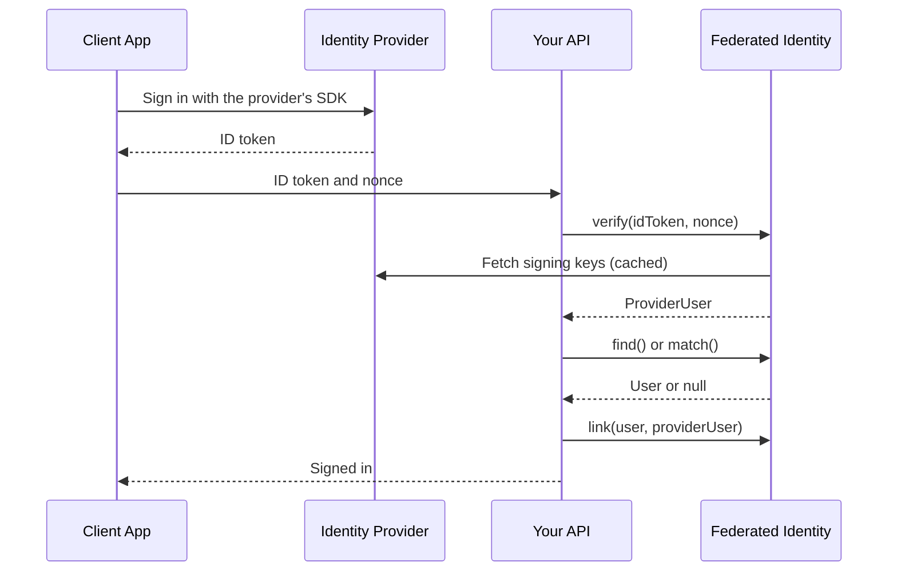

# Federated Identity for Laravel

<p align="center">
<a href="https://github.com/X-Laravel/federated-identity/actions/workflows/tests.yml"></a>
<a href="https://packagist.org/packages/x-laravel/federated-identity" rel="nofollow"></a>
<a href="https://packagist.org/packages/x-laravel/federated-identity" rel="nofollow"></a>
<a href="https://packagist.org/packages/x-laravel/federated-identity" rel="nofollow"></a>
<a href="https://packagist.org/packages/x-laravel/federated-identity" rel="nofollow"></a>
</p>

- [Introduction](#introduction)
    - [How It Works](#how-it-works)
- [Installation](#installation)
- [Configuration](#configuration)
    - [Signing Keys](#signing-keys)
- [Authentication](#authentication)
    - [Verifying Tokens](#verifying-tokens)
    - [Finding and Linking Users](#finding-and-linking-users)
    - [Registering Users](#registering-users)
    - [Nonces](#nonces)
    - [Names From Apple](#names-from-apple)
- [Managing Linked Accounts](#managing-linked-accounts)
- [Revoking Apple Tokens](#revoking-apple-tokens)
- [Adding Providers](#adding-providers)
    - [OpenID Connect Providers](#openid-connect-providers)
    - [Custom Verifiers](#custom-verifiers)
- [Customizing User Lookup](#customizing-user-lookup)
- [Exceptions](#exceptions)
- [Events](#events)
- [Customizing Messages](#customizing-messages)
- [License](#license)

<a name="introduction"></a>
## Introduction

Federated identity lets your users sign in with an account they already have at Google, Apple or another OpenID Connect provider, and links that account to a user of your application.

Mobile and single-page applications usually sign users in with the provider's own SDK, then send the resulting ID token to your API. This package verifies that token and tells you which of your users it belongs to. It supports Google and Apple out of the box, and any other OpenID Connect provider through configuration.

A token is accepted only when its signature matches the provider's published keys, its issuer and expiry are valid, and it was issued to one of your own client IDs. Provider accounts are matched to your users by the provider's stable user ID, never by email alone. Creating new users stays with your application.

> [!NOTE]
> This package verifies ID tokens. Providers that issue no ID token, such as GitHub or X, should use the redirect flow of [Laravel Socialite](https://laravel.com/docs/socialite).

<a name="how-it-works"></a>
### How It Works

The following diagram shows a sign-in from the moment the user taps the provider's button. Signing the user in and creating new users are left to your application:



When a check fails, the verifier throws an `InvalidTokenException`, or a `ProviderUnavailableException` when the signing keys cannot be fetched. When a user with the email address exists but cannot be linked safely, `match` throws an `AccountExistsException`. These are described in the [exceptions](#exceptions) section.

<a name="installation"></a>
## Installation

To get started, use the Composer package manager to add the package to your project's dependencies:

```shell
composer require x-laravel/federated-identity
```

Next, publish and run the migration that creates the `user_identities` table:

```shell
php artisan vendor:publish --tag=federated-identity-migrations

php artisan migrate
```

The table references your users table with a `foreignId` column. If your users have UUID keys, edit the published migration before running it.

Finally, add the `HasFederatedIdentities` trait to your user model:

```php
use XLaravel\FederatedIdentity\Concerns\HasFederatedIdentities;

class User extends Authenticatable implements MustVerifyEmail
{
    use HasFederatedIdentities;
}
```

<a name="configuration"></a>
## Configuration

Before verifying tokens, you will need to add the client IDs of the applications your users sign in with. Each provider may have several: a web client, an iOS client and an Android client, for example. A token is accepted only when it was issued to one of them.

For Google and Apple, you may simply set the client IDs in your application's `.env` file:

```ini
FEDERATED_IDENTITY_GOOGLE_CLIENT_IDS=web-id.apps.googleusercontent.com,ios-id.apps.googleusercontent.com
FEDERATED_IDENTITY_APPLE_CLIENT_IDS=com.example.web,com.example.app
```

To add providers or change any other option, publish the configuration file:

```shell
php artisan vendor:publish --tag=federated-identity-config
```

Providers are defined in the `providers` array of the `config/federated-identity.php` configuration file. The key of each entry is the provider's name, which you pass to the `verifier` method and which is stored in the `user_identities` table:

```php
'providers' => [
    'google' => [
        'client_ids' => env('FEDERATED_IDENTITY_GOOGLE_CLIENT_IDS', ''),
    ],

    'apple' => [
        'client_ids' => env('FEDERATED_IDENTITY_APPLE_CLIENT_IDS', ''),
        'team_id' => env('FEDERATED_IDENTITY_APPLE_TEAM_ID'),
        'key_id' => env('FEDERATED_IDENTITY_APPLE_KEY_ID'),
        'private_key' => env('FEDERATED_IDENTITY_APPLE_PRIVATE_KEY'),
    ],
],
```

The `client_ids` option accepts an array or a comma-separated string. Apple's `team_id`, `key_id` and `private_key` options are only needed to [revoke tokens](#revoking-apple-tokens). Any provider may also define a `label`, which is the name shown in error messages.

The configuration file also contains the `leeway` option, the number of seconds of clock difference allowed when checking a token's issue and expiry times, the `provider` option, the [user provider](#customizing-user-lookup) your users are looked up through, and the `table`, `connection` and `model` options of the identity table. A custom `model` must extend `XLaravel\FederatedIdentity\Models\Identity`.

<a name="signing-keys"></a>
### Signing Keys

Each provider's public signing keys are cached for as long as the provider's `Cache-Control` header allows, or for `cache.ttl` seconds when it sends none. When a token is signed with a key that is not in the cache, the keys are fetched again, so key rotations need no action. To keep forged tokens from flooding the provider with requests, the keys are refetched at most once every `cache.refresh_after` seconds. The same wait applies after a failed fetch, so an unreachable provider is not retried on every request; tokens signed with a cached key are still verified in the meantime.

<a name="authentication"></a>
## Authentication

<a name="verifying-tokens"></a>
### Verifying Tokens

To verify a token, retrieve the provider's verifier using the `verifier` method of the `FederatedIdentity` facade and pass the token to its `verify` method:

```php
use XLaravel\FederatedIdentity\Facades\FederatedIdentity;

$providerUser = FederatedIdentity::verifier('google')->verify($request->input('id_token'));
```

The `verify` method returns an `XLaravel\FederatedIdentity\ProviderUser` instance. If the token is not valid, an `XLaravel\FederatedIdentity\Exceptions\InvalidTokenException` is thrown:

```php
$providerUser->provider;      // "google"
$providerUser->id;            // The provider's user ID ("sub")
$providerUser->audience;      // The client ID the token was issued to
$providerUser->email;
$providerUser->emailVerified;
$providerUser->givenName;
$providerUser->familyName;
$providerUser->avatarUrl;
$providerUser->claims;        // Every claim of the token

$providerUser->name();
```

You may determine if a provider is configured using the `has` method, and retrieve the names of all providers using the `providers` method:

```php
if (FederatedIdentity::has($provider)) {
    // ...
}

$providers = FederatedIdentity::providers();
```

<a name="finding-and-linking-users"></a>
### Finding and Linking Users

Once the token has been verified, you may use the `IdentityResolver` to determine which of your users it belongs to. The `find` method returns the user the provider account is linked to, even if its email address has changed since:

```php
use XLaravel\FederatedIdentity\IdentityResolver;

$user = app(IdentityResolver::class)->find($providerUser);
```

If the provider account is not linked yet, the `match` method looks for an existing user with the same email address. It returns the user only when it is safe to link them: the provider has verified the email address, your application has verified it too, and the user has no other account of the same provider linked. You may then link the provider account to the user using the `link` method:

```php
$resolver = app(IdentityResolver::class);

$user = $resolver->find($providerUser);

if ($user === null && $user = $resolver->match($providerUser)) {
    $resolver->link($user, $providerUser);
}
```

> [!NOTE]
> Google vouches for an email address only when it is a Gmail address or belongs to a Google Workspace account, so `emailVerified` is `false` for a Google account that uses any other address. The value Google sent remains available in the `claims` property.

The `find` and `match` methods never write to the database, so you are free to ask the user to confirm before linking the accounts. When no user has the email address, `match` returns `null` and you may [register a new user](#registering-users).

When a user with the email address exists but it is not safe to link them, `match` throws an `XLaravel\FederatedIdentity\Exceptions\AccountExistsException`. The user should sign in another way and link the provider account from their settings. If you would rather never link accounts by email, set the `link_by_email` configuration option to `false`; `match` will then throw the exception whenever a user with the email address exists.

<a name="registering-users"></a>
### Registering Users

This package never creates users, since which attributes a user needs and what should happen when they sign up is up to your application. If no user is linked to the provider account and none has its email address, you will typically create a new user and link the provider account to them:

```php
use App\Models\User;
use Illuminate\Support\Facades\Hash;
use Illuminate\Support\Str;
use XLaravel\FederatedIdentity\Exceptions\IdentityTakenException;

$user = User::create([
    'name' => $providerUser->name(),
    'email' => $providerUser->email,
    'email_verified_at' => $providerUser->emailVerified ? now() : null,
    'password' => Hash::make(Str::random(40)),
]);

try {
    $resolver->link($user, $providerUser);
} catch (IdentityTakenException $exception) {
    $user->forceDelete();

    $user = $resolver->find($providerUser) ?? throw $exception;
}
```

Two requests may sign up the same provider account at the same moment. The request that links the account second receives an `IdentityTakenException`, removes the user it just created, and continues with the user created by the first request.

Providers do not always share the user's name. Apple never includes it in the token, and the user may choose not to share it at all. You should store the name as the provider sent it, keep the column nullable, and ask users without a name to complete their profile.

If signing up requires another step, such as accepting your terms of service, you may respond to the first request without creating the user and have the client send the ID token again along with the step's data. ID tokens are valid for about an hour, so verify the token again before creating the user.

<a name="nonces"></a>
### Nonces

A nonce binds a token to the sign-in that requested it. The client passes the SHA-256 hex digest of a random string to the provider's SDK, and sends the original string to your API along with the token. Pass the nonce to the `verify` method as its second argument:

```php
$providerUser = FederatedIdentity::verifier('apple')->verify(
    $request->input('id_token'),
    $request->input('nonce'),
);
```

Apple tokens always require a nonce. Other providers verify the nonce when you pass one, and accept tokens without one unless their configuration sets the `nonce` option to `true`.

> [!WARNING]
> A nonce generated by the client does not stop replays, since anyone who captures the request can send the same token and nonce again. To reject replayed tokens, have your API issue the nonce, store it, and delete it the first time a token is verified with it.

<a name="names-from-apple"></a>
### Names From Apple

Apple returns the user's name to the client only on the first sign in, and never includes it in the token. Have the client send the name along with the token, then add it using the `withName` method:

```php
$providerUser = $providerUser->withName(
    $request->input('given_name'),
    $request->input('family_name'),
);
```

The `withName` method never overwrites a name the token already contains.

<a name="managing-linked-accounts"></a>
## Managing Linked Accounts

The `link` method may also be used to connect a provider account to a signed in user, for example from your application's account settings. Linking the same account to the same user again has no effect:

```php
$identity = $resolver->link($request->user(), $providerUser);
```

If the provider account is linked to another user, an `XLaravel\FederatedIdentity\Exceptions\IdentityTakenException` is thrown. If the user already has another account of the same provider linked, an `XLaravel\FederatedIdentity\Exceptions\AlreadyLinkedException` is thrown.

To remove a linked account, pass the user and the provider's name to the `unlink` method. Whether a user may remove their last way of signing in is up to your application, so you should check it before calling `unlink`:

```php
$resolver->unlink($request->user(), 'apple');
```

The `owns` method determines if a provider account is linked to the given user. This is useful when the user should confirm their identity again, such as before deleting their account:

```php
if ($resolver->owns($request->user(), $providerUser)) {
    // ...
}
```

You may retrieve the linked accounts from the user model using the methods of the `HasFederatedIdentities` trait:

```php
$user->identities;

$identity = $user->identity('google');

if ($user->hasIdentity('apple')) {
    // ...
}
```

<a name="revoking-apple-tokens"></a>
## Revoking Apple Tokens

When a user who signed in with Apple deletes their account, the App Store requires your application to revoke the user's tokens. To do so, have the client sign in with Apple once more and send the authorization code along with the token. Then, pass the code to the `revoke` method of the revoker returned by the `revoker` method:

```php
$providerUser = FederatedIdentity::verifier('apple')->verify(
    $request->input('id_token'),
    $request->input('nonce'),
);

FederatedIdentity::revoker('apple')->revoke(
    $providerUser->audience,
    $request->input('authorization_code'),
    $request->input('redirect_uri'),
);
```

The `revoke` method exchanges the code for a refresh token and revokes it. The client secret is signed with the provider's private key for the client ID the token was issued to. The redirect URI is only needed for codes obtained from a sign in on the web.

If you already have a refresh or access token, you may revoke it directly using the `revokeToken` method. The signed client secret for other Apple endpoints may be retrieved using the `appleClientSecret` method:

```php
FederatedIdentity::revoker('apple')->revokeToken($clientId, $refreshToken);

$secret = FederatedIdentity::appleClientSecret('apple')->for($clientId);
```

<a name="adding-providers"></a>
## Adding Providers

<a name="openid-connect-providers"></a>
### OpenID Connect Providers

Any provider that issues OpenID Connect ID tokens and publishes its signing keys may be added to the `providers` configuration array using the `oidc` driver. The `issuer` and `jwks_uri` values may be found in the provider's `/.well-known/openid-configuration` document:

```php
'providers' => [
    // ...

    'microsoft' => [
        'driver' => 'oidc',
        'issuer' => 'https://login.microsoftonline.com/{tenant-id}/v2.0',
        'jwks_uri' => 'https://login.microsoftonline.com/{tenant-id}/discovery/v2.0/keys',
        'client_ids' => env('FEDERATED_IDENTITY_MICROSOFT_CLIENT_IDS'),
    ],

    'keycloak' => [
        'driver' => 'oidc',
        'label' => 'Company Account',
        'issuer' => 'https://sso.example.com/realms/staff',
        'jwks_uri' => 'https://sso.example.com/realms/staff/protocol/openid-connect/certs',
        'client_ids' => 'mobile-app,web-app',
        'nonce' => true,
    ],
],
```

The `issuer` option accepts a string, an array, or a comma-separated string, so a provider that signs tokens under more than one issuer value may list all of them. The issuers and the `jwks_uri` must use `https`. The `google` and `apple` drivers may be used the same way to configure a built-in provider under another name.

<a name="custom-verifiers"></a>
### Custom Verifiers

If a provider needs its own verification logic, you may register it using the `extend` method of the `FederatedIdentity` facade. Typically, this should be done within the `boot` method of one of your application's service providers. The closure receives the container, the provider's configuration array and its name:

```php
use XLaravel\FederatedIdentity\Facades\FederatedIdentity;
use XLaravel\FederatedIdentity\Verifiers\OidcTokenVerifier;

/**
 * Bootstrap any application services.
 */
public function boot(): void
{
    FederatedIdentity::extend('line', function ($app, array $config, string $name) {
        return new OidcTokenVerifier(
            name: $name,
            label: 'LINE',
            keys: FederatedIdentity::keySet($name, 'https://api.line.me/oauth2/v2.1/certs'),
            issuers: ['https://access.line.me'],
            clientIds: [$config['channel_id']],
        );
    });
}
```

The `keySet` method returns a key set that uses the package's signing key cache. You may extend the `OidcTokenVerifier` class and override its `user` method to map other claims, or implement the `XLaravel\FederatedIdentity\Contracts\TokenVerifier` interface yourself.

<a name="customizing-user-lookup"></a>
## Customizing User Lookup

The resolver looks users up through one of the user providers defined in your application's `config/auth.php` configuration file, the `users` provider by default. Users are found by their key using the provider's `retrieveById` method and by their email address using its `retrieveByCredentials` method, and an email address is considered verified when the user implements `MustVerifyEmail` and its `hasVerifiedEmail` method returns `true`. The identity table belongs to the provider's `model`.

To look users up differently, such as to include soft deleted users or to compare email addresses regardless of case, register a [custom user provider](https://laravel.com/docs/authentication#adding-custom-user-providers) and set the `provider` configuration option to the name of the provider that uses it:

```php
'provider' => 'identity-users',
```

> [!NOTE]
> If your user model does not implement `MustVerifyEmail`, users are never linked by email.

<a name="exceptions"></a>
## Exceptions

Every exception thrown by the package extends `XLaravel\FederatedIdentity\Exceptions\FederatedIdentityException`, contains the provider's name in its `provider` property, and has a translated message that may be shown to the user:

- `InvalidTokenException` is thrown when the token's signature, issuer, expiry, audience or nonce is not valid.
- `ProviderUnavailableException` is thrown when the provider's signing keys cannot be fetched. The original exception is available through the `getPrevious` method.
- `EmailMissingException` is thrown by `match` when the provider account has no email address.
- `AccountExistsException` is thrown by `match` when a user with the email address exists but cannot be linked automatically.
- `IdentityTakenException` is thrown by `link` when the provider account is linked to another user.
- `AlreadyLinkedException` is thrown by `link` when the user already has another account of the same provider linked.

When Apple cannot be reached while revoking a token, Laravel's `ConnectionException` or `RequestException` is thrown instead. Requesting a provider that is neither configured nor registered throws an `InvalidArgumentException`.

<a name="events"></a>
## Events

The package dispatches the `XLaravel\FederatedIdentity\Events\IdentityLinked` and `XLaravel\FederatedIdentity\Events\IdentityUnlinked` events, which contain the `user` and the `identity`. Both are dispatched after the surrounding database transaction has been committed.

<a name="customizing-messages"></a>
## Customizing Messages

To customize the package's messages, publish the language files using the `vendor:publish` Artisan command. The files will be placed in your application's `lang/vendor/federated-identity` directory:

```shell
php artisan vendor:publish --tag=federated-identity-translations
```

<a name="license"></a>
## License

Federated Identity for Laravel is open-sourced software licensed under the [MIT license](LICENSE).
